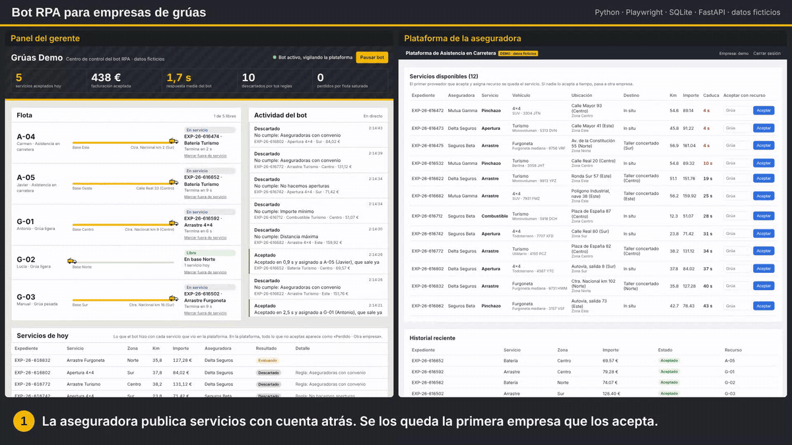
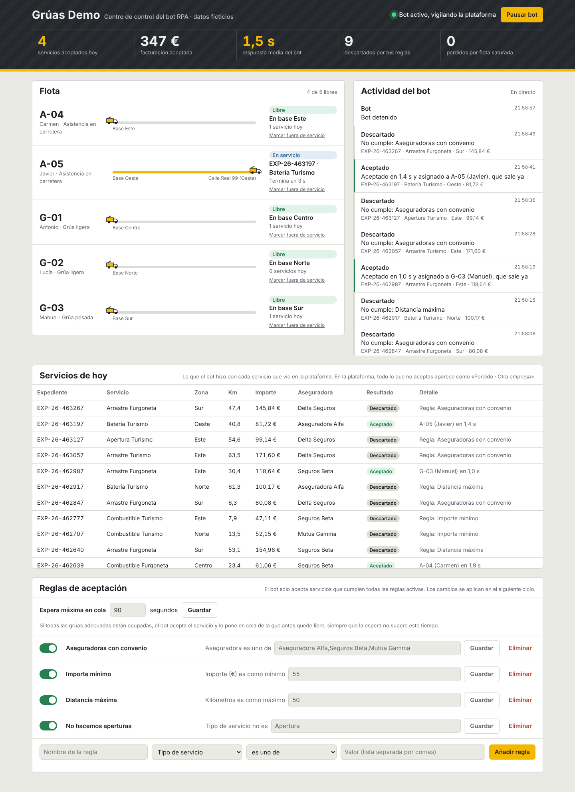
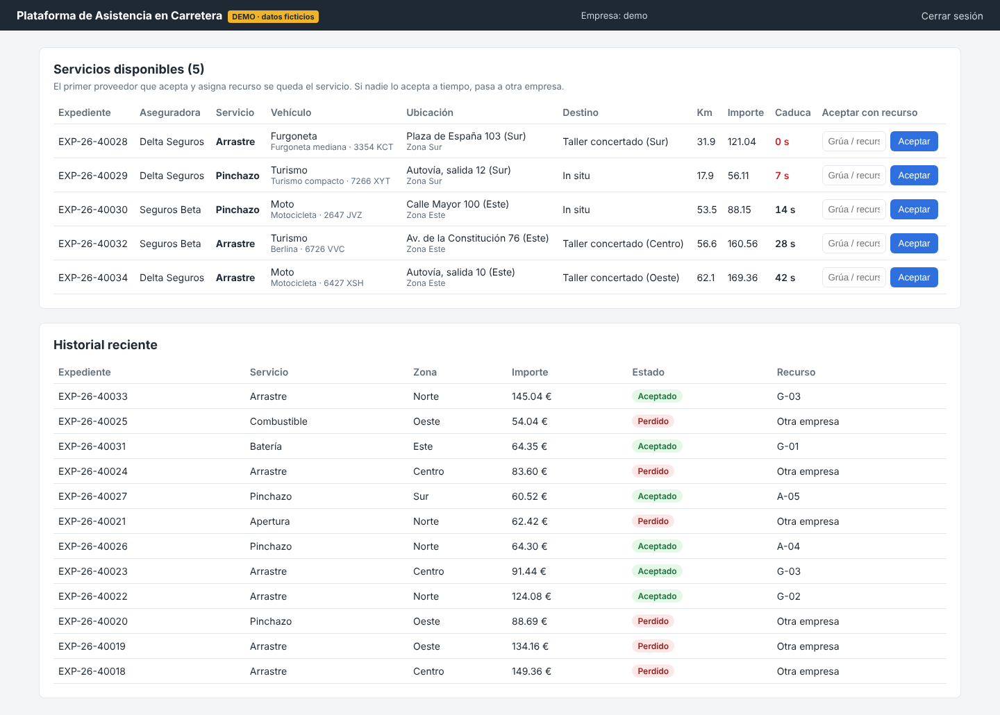

# Bot RPA para empresas de grúas

Simulador completo de cómo una empresa de grúas automatiza la captación de servicios. Un **bot RPA** vigila la plataforma web donde las aseguradoras publican servicios, **acepta en segundos** los que encajan con las reglas de la empresa, **asigna la grúa adecuada** de la flota y avisa por **Telegram**. El gerente lo controla todo desde un **panel web**, sin tocar código.

Es una versión genérica y pública de un sistema que desarrollé en producción para una empresa de grúas que trabajaba 24/7. No contiene código ni datos de ningún cliente: la plataforma, las aseguradoras, los conductores y los servicios son ficticios.



▶️ [Vídeo completo de la demo (70 s)](docs/demo.mp4): aceptación automática, colas cuando faltan grúas y cambio de reglas desde el panel.

Forma parte de mi portfolio: [ismael-sanchez.vercel.app](https://ismael-sanchez.vercel.app).

## El problema

Las aseguradoras publican los servicios de asistencia (arrastres, baterías, pinchazos…) en plataformas web. **Se los queda la primera empresa que los acepta**, y si nadie lo hace a tiempo pasan a otra. Hacerlo a mano exige tener a alguien pegado a la pantalla día y noche, decidir en segundos si el servicio compensa (zona, kilómetros, importe, aseguradora) y averiguar qué grúa está libre y cerca.

Este proyecto automatiza ese trabajo de principio a fin:

| Sin bot | Con bot |
|---|---|
| Una persona vigilando la plataforma | El bot revisa la plataforma cada pocos segundos, 24/7 |
| Se pierden servicios por llegar tarde | Acepta en unos 2-4 s desde que se publica el servicio |
| Criterios en la cabeza del operador | Reglas escritas, visibles y editables desde el panel |
| Asignar la grúa a ojo o por teléfono | Elige la grúa más adecuada por tipo y zona, o la pone en cola si están todas ocupadas |
| Sin datos | Métricas del día: aceptados, facturación, perdidos y motivos |

## Cómo funciona

| Panel de control | Plataforma de asistencia (ficticia) |
|---|---|
|  |  |

El sistema tiene tres piezas:

1. **Plataforma de asistencia (ficticia).** Simula la web de las aseguradoras. Publica servicios cada pocos segundos con expediente, aseguradora, vehículo, matrícula, ubicación, destino, km, importe y una cuenta atrás. Para aceptar un servicio hay que indicar qué recurso (grúa) lo hará.
2. **Bot RPA.** Entra en la plataforma con Playwright, como lo haría una persona. En cada ciclo:
   - lee los servicios publicados;
   - los evalúa contra las reglas activas;
   - elige la grúa adecuada, libre o con la cola más corta;
   - escribe la grúa en la plataforma y pulsa «Aceptar»;
   - registra la decisión y su motivo en SQLite y avisa por Telegram.
3. **Panel de control.** Es lo que ve el gerente:
   - los servicios entrando y la decisión del bot en directo;
   - la flota con el estado de cada grúa (libre, en camino, en servicio) y los servicios que tiene en cola;
   - una tabla con cada servicio del día y qué hizo el bot con él (aceptado y con qué grúa, o descartado y por qué regla);
   - las reglas y la espera máxima en cola, editables;
   - un botón para pausar el bot;
   - la opción de marcar una grúa como fuera de servicio.

```
 Plataforma de asistencia            Bot RPA (Playwright)                 Panel de control
 ┌───────────────────────┐  login,   ┌──────────────────────┐            ┌────────────────────┐
 │ servicios publicados  │◀─ leer ───│ rules.py  ¿encaja?   │            │ KPIs del día       │
 │ cuenta atrás          │  aceptar  │ fleet.py  ¿qué grúa? │──SQLite───▶│ flota en directo   │
 │ aceptar con recurso   │◀──────────│ main.py   bucle 24/7 │◀──reglas───│ actividad del bot  │
 └───────────────────────┘           └──────────┬───────────┘            │ reglas · pausa     │
                                                │ Telegram               └────────────────────┘
                                                ▼
                                       "EXP-26-40012 aceptado en 2,4 s,
                                        asignado a G-02 (Lucía)"
```

### Asignación de grúas

- Un **arrastre** necesita grúa. Si el vehículo es una furgoneta, tiene que ser una **grúa pesada**.
- Batería, pinchazo, combustible y apertura los puede hacer cualquier unidad, pero el bot prefiere un **vehículo de asistencia** para no bloquear grúas.
- **Si todas las grúas adecuadas están ocupadas, el bot acepta igualmente** y pone el servicio en cola de la que antes vaya a quedar libre. Así trabaja una empresa real: no se rechaza un servicio porque las grúas estén en la calle.
- Para elegir, el bot calcula un coste para cada unidad válida: los segundos de espera en cola, más una penalización por la distancia entre su zona base y la del servicio, y otra por usar una unidad «de más». Así no manda la única grúa pesada a cambiar una batería, y una grúa cercana que se libera en 10 s puede ganar a una libre en la otra punta.
- Hay una **espera máxima en cola**, configurable desde el panel. Si todas las unidades adecuadas tardarían más en salir, el bot no acepta el servicio, porque no podría cumplir con la aseguradora. Lo reintenta mientras siga publicado y, si caduca, lo registra como **perdido por flota saturada**. Es un dato útil para dimensionar la flota.

### Reglas

Las reglas viven en la base de datos y se editan desde el panel. Un servicio se acepta solo si cumple todas las reglas activas.

| Campo | Condiciones | Ejemplo |
|---|---|---|
| Tipo de servicio | es / no es / es uno de / no es ninguno de | No hacemos aperturas |
| Zona | ídem | Solo Centro, Norte y Este |
| Aseguradora | ídem | Solo aseguradoras con convenio |
| Tipo de vehículo | ídem | No aceptamos motos |
| Kilómetros | mínimo / máximo / mayor / menor | Como máximo 50 km |
| Importe (€) | ídem | Como mínimo 55 € |

## Stack

- **Python 3.11+** con tipado y dataclasses
- **Playwright** para la automatización del navegador (RPA)
- **SQLite** (modo WAL) compartido entre el bot y el panel
- **FastAPI + Jinja2** para la plataforma ficticia; **FastAPI + HTML/JS** sin frameworks para el panel
- **pydantic-settings** para la configuración desde `.env`
- **Telegram Bot API** para los avisos
- **pytest** (44 tests: reglas, asignación y colas de la flota, base de datos y migraciones)
- **Docker Compose** para levantar las tres piezas y **Caddy** como proxy con HTTPS en producción

## Cómo ejecutarlo

### En local (un solo comando)

```bash
python -m venv .venv
.venv\Scripts\activate             # Windows  (Linux/macOS: source .venv/bin/activate)
pip install -r requirements.txt
playwright install chromium        # o pon BROWSER_CHANNEL=msedge en .env para usar Edge
cp .env.example .env

python run_demo.py                 # arranca plataforma, panel y bot y abre el navegador
python run_demo.py --reset         # igual, empezando con el historial vacío
python run_demo.py --show          # muestra el navegador del bot mientras trabaja
```

- Panel de control: http://localhost:8001
- Plataforma: http://localhost:8000 (usuario `demo`, contraseña `demo1234`)

Algunas pruebas para la demo:
- Pausa el bot y verás cómo los servicios caducan y se van a «otra empresa».
- Marca varias grúas como fuera de servicio y verás cómo se llenan las colas y, al superar la espera máxima, aparecen servicios perdidos por flota saturada.
- Cambia el importe mínimo y verás cómo cambia lo que acepta el bot en el siguiente ciclo.

### Con Docker

```bash
cp .env.example .env
docker compose up --build
```

### En un servidor público

La guía [DEPLOY.md](DEPLOY.md) explica cómo publicarlo en un servidor Linux gratuito (Oracle Cloud Always Free) con Docker Compose, HTTPS automático con Caddy y modo demo pública, que restablece la demo cada hora porque todos los visitantes la comparten.

### Tests

```bash
pytest
```

## Avisos por Telegram

1. Crea un bot con [@BotFather](https://t.me/BotFather) y copia el token.
2. Escríbele un mensaje a tu bot y obtén tu `chat_id` en `https://api.telegram.org/bot<TOKEN>/getUpdates`.
3. Rellena `TELEGRAM_BOT_TOKEN` y `TELEGRAM_CHAT_ID` en `.env`.

Sin esos valores, el bot funciona igual y muestra los avisos en el log.

## Estructura

```
├── portal/               # Plataforma de asistencia ficticia (FastAPI + Jinja2)
├── bot/
│   ├── main.py           # Bucle del bot: leer, decidir, asignar, aceptar, avisar
│   ├── scraper.py        # Playwright: login, lectura de servicios, aceptación
│   ├── rules.py          # Motor de reglas
│   ├── fleet.py          # Asignación de grúas, colas y ciclo de vida del servicio
│   ├── db.py             # SQLite: reglas, flota, servicios, trabajos, eventos
│   ├── notifier.py       # Telegram
│   ├── demo.py           # Flota y reglas de ejemplo, reinicio de la demo pública
│   ├── models.py         # Modelos de dominio
│   └── config.py         # Configuración desde .env
├── dashboard/            # Panel de control (API FastAPI + página estática)
├── scripts/seed.py       # Carga flota y reglas de ejemplo
├── tests/
├── run_demo.py           # Arranca todo con un comando
├── Dockerfile · portal/Dockerfile · docker-compose.yml · docker-compose.prod.yml
├── deploy/Caddyfile      # Proxy HTTPS para el despliegue público
├── DEPLOY.md             # Guía de despliegue en servidor
├── tools/demo-video/     # Script para grabar el vídeo y el GIF de la demo
└── docs/                 # Capturas, GIF y vídeo
```

## Notas

- Los tiempos están comprimidos para la demo: un servicio completo dura segundos, no horas. Se ajustan en `bot/fleet.py`.
- El panel no tiene login porque es una demo local. En producción iría detrás de autenticación.
- En un caso real, el bot se despliega en un VPS Linux como servicio (systemd o Docker con `restart: unless-stopped`) para funcionar 24/7.

## Autor

**Ismael Sánchez Gragera**, desarrollador Python. [Portfolio](https://ismael-sanchez.vercel.app) · [LinkedIn](https://www.linkedin.com/in/ismael-sg) · [isanchezg2003@gmail.com](mailto:isanchezg2003@gmail.com)
